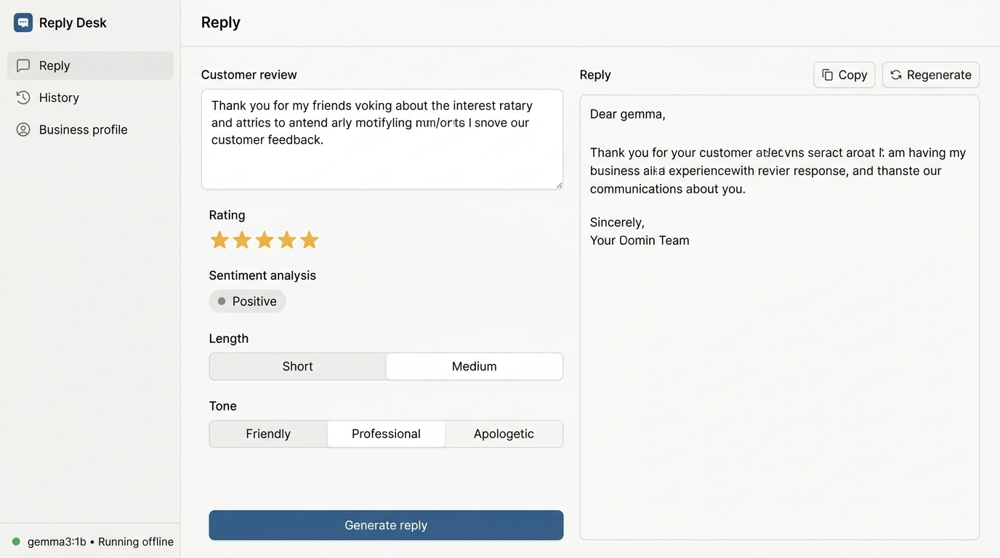

# Reply Desk

> Paste a customer review. Get a ready-to-post reply in your voice. Runs on your own computer.

Reply Desk is a privacy-first, local review reply generator designed for small business owners—cafes, hair salons, auto repair shops, dental clinics, and local stores—who dread writing review replies or don't want to pay monthly SaaS fees.

Built from scratch for the **DEV Hacktoberfest Open-Source AI Challenge Week 2 (Theme: Side Hustle)**, powered by open-source AI running completely on your local machine using **Ollama** and **Gemma 3 1B**.



---

## Key Features

- **Split-Screen Utility Layout**: Clean two-pane interface—customer review and controls on the left, live generated reply on the right.
- **Auto-Detected Sentiment**: Automatically classifies review sentiment as **Positive**, **Neutral**, or **Negative**, with full manual override.
- **Star Rating Aware**: Select 1 to 5 stars as context hints for tone and sentiment.
- **Tone & Length Customization**: Choose between **Friendly**, **Professional**, or **Apologetic** tones, and toggle between **Short** (1–2 sentences) or **Medium** (2–3 sentences) lengths.
- **Local Business Profile**: Configure your business name, industry, manager name, preferred sign-off, custom tone guidelines, and a strict "Things to never say" list (e.g., never promise refunds or discounts).
- **History & Search**: Automatically stores every generated review and reply locally with search, one-click reload into editor, and deletion.
- **100% Offline & Private**: Zero accounts, zero external API keys, zero tracking. All processing is executed via local Ollama on `localhost:11434`.
- **Preloaded Samples**: Includes 10 realistic test reviews across multiple industries (cafes, salons, repair shops, dental clinics, restaurants).

---

## Why It Runs Offline

1. **Absolute Privacy for Sensitive Customer Data**:
   Customer reviews often mention personal names, employee interactions, service complaints, or billing disputes. Running open-source AI locally ensures this data never leaves your machine or trains external commercial models.
2. **Zero Recurring SaaS Costs**:
   Third-party review management tools charge small businesses $30–$100/month. Reply Desk runs entirely on free, open-source AI with zero subscriptions.
3. **No Rate Limits or Internet Dependency**:
   Whether your internet is spotty or completely offline, your review response tool continues to run instantly without third-party API downtime, token quotas, or billing surprises.

---

## Prerequisites

1. **Node.js** (v18 or newer)
2. **Ollama**: Download and install from [ollama.com](https://ollama.com)

Pull the Gemma 3 1B open-source model:

```bash
ollama pull gemma3:1b
```

Ensure Ollama is running:

```bash
ollama serve
```

---

## Quick Start

1. **Clone and install dependencies**:

   ```bash
   git clone https://github.com/madhav-1204/Reply-Desk.git
   cd Reply-Desk
   npm install
   ```

2. **Start the application**:

   ```bash
   npm run dev
   ```

3. **Open the browser**:
   Navigate to [http://localhost:3000](http://localhost:3000).

---

## How It Works (AI Pipeline)

Reply Desk runs a 3-step structured pipeline using Ollama's local HTTP API:

1. **Step 1: Sentiment Classification**:
   Uses a compact few-shot prompt with a low temperature (0.1) returning a single sentiment token (`positive`, `neutral`, or `negative`). Incorporates the star rating as a heuristic and falls back gracefully if model output is ambiguous.
2. **Step 2: Voice & Constraint Prompting**:
   Combines your Business Profile, chosen tone, length instructions, and strict negative constraints ("never promise refunds", "never admit legal fault", "only reference details in the review") with matched few-shot examples for Gemma 3 1B.
3. **Step 3: Post-Processing & Normalization**:
   Strips preamble (e.g., *"Here is your reply:"*), removes quotes and markdown artifacts, enforces sentence limits, and cleanly appends your configured business sign-off.

---

## Project Structure

```
Reply-Desk/
├── data/
│   └── db.json               # Local JSON database (profile and history)
├── public/
│   ├── app.js                # Frontend controller & SSE streaming logic
│   ├── index.html            # Semantic two-pane utility interface
│   └── styles.css            # Flat, quiet, accessible design system
├── samples/
│   ├── reviews.json          # 10 curated test reviews across industries
│   ├── sample_1_cafe_positive.txt
│   ├── sample_2_coffee_neutral.txt
│   └── sample_3_bikeshop_negative.txt
├── server/
│   ├── db.js                 # Safe atomic local storage manager
│   ├── index.js              # Express server & SSE streaming routes
│   └── ollama.js             # Ollama client, prompts, & post-processor
├── DEMO.md                   # 60-second walkthrough script
├── package.json
└── README.md
```

---

## License

MIT License. Free and open-source for personal and commercial use.
